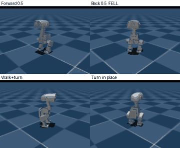
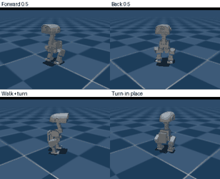
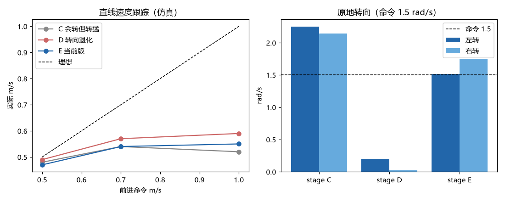

# XGO 小鸭子行走策略（从零训练 · stage N 地毯版）



XGO Duck 双足小鸭子的强化学习行走策略：在 mjlab（MuJoCo Warp）里从随机初始化开始训练，分阶段加入速度、转向、步频奖励。当前 **stage N** 专门在**软地毯**接触上训练，在地毯上前进约 1 m/s、后退约 0.85 m/s，基本不摔。**只在仿真中验证，还没上真机；地毯参数是估计值。**

| 项目 | 数值（仿真，软地毯 + 摩擦 0.6–1.0，48 只鸭子平均） |
|---|---|
| 前进 | 命令 0.7 → 0.74 m/s，1.0 → 0.87，1.2 → **0.98** |
| 后退 | 命令 −1.0 → −0.82，−1.2 → **−0.85** |
| 转向 | 原地转命令 1.5 → 2.2–2.4 rad/s（偏快约 50%）；1.0 前进 + 左转 → 0.89 m/s / 0.48 rad/s |
| 摔倒率 | 各档 0–2% |
| 硬地面 | 会变慢、后退易摔（−1.0 档 15%）；硬地面请用 stage G |
| 训练量 | 约 6800 轮，4096 并行环境，RTX 4060 笔记本单卡 |
| 模型 | `models/xgoduck_walk_stageN_carpet.onnx`（E、F、G 也在 models/） |

## stage N：地毯上冲 1 m/s

<table><tr>
<td></td>
<td>

| 命令（地毯） | G | J | **N** |
|---|---|---|---|
| 前进 0.7 | — | 0.78 / 摔 35% | **0.74 / 0%** |
| 前进 1.0 | — | 0.95 / 44% | **0.87 / 2%** |
| 前进 1.2 | — | 0.97 / 83% | **0.98 / 0%** |
| 后退 1.0 | — | −0.74 / 10% | **−0.82 / 2%** |
| 后退 1.2 | — | −0.74 / 23% | **−0.85 / 0%** |
| 1.0 + 左转 | — | 摔 73% | **0.89 / 2%** |

</td></tr></table>

从 G 往上的路线：H 从零训、步频更快；I 去掉姿态约束（硬地面 0.6 → 0.75–0.8，但开始摔）；J/K/L 试摔倒惩罚，罚轻了没用、罚重了不走；按摔倒前半秒分析，摔倒主要来自落脚打滑，并且集中在很滑的地面上。用户的鸭子在地毯上走，于是 M/N 直接在软地毯接触上训练，速度和摔倒同时解决。

## stage G：改步态（硬地面推荐）

<table><tr>
<td></td>
<td>

| 命令 | E | **G** |
|---|---|---|
| 前进 0.5 | 0.47 | **0.51** |
| 前进 0.7 | 0.54 | **0.59** |
| 前进 1.0 | 0.54 | **0.60** |
| 前进 1.2 | 0.56 | **0.61** |
| 后退 1.0 | −0.46 | **−0.55** |
| 原地转 1.5 | 1.54 / −1.76 | **1.78 / −1.81** |
| 0.5 + 转 1.5 | 0.42 / 1.54 | 0.42 / 1.51 |
| 步频（步/秒） | 2.2 | **2.45** |

</td></tr></table>

G 在 E 的基础上加了步频奖励，速度、后退、原地转都比 E 好一点，模型 `models/xgoduck_walk_stageG.onnx`。还没上真机。

## 各阶段对比

<table><tr>
<td></td>
</tr><tr>
<td>C 学会了转但转过头约 45%；D 把转向收过头，原地几乎不转；E 取中间值，转向跟上、速度不退步。直线速度目前都卡在约 0.55 m/s。</td>
</tr></table>

## 版本演进

| 阶段 | 做了什么 | 结果 |
|---|---|---|
| A | 从零学走路：窄速度核 std 0.22、命令 ±0.6、关节超速惩罚 | 会走 |
| B | 命令 ±1.0、步幅 ×1.8、腾空 0.15–0.5 s、线速度“进度”奖励 | 0.5–0.6 m/s，不会原地转 |
| C | 加转向“进度”奖励（权重 4） | 会转，但 1.5 → 2.25 rad/s 转过头 |
| D | 转向奖励降到 1、容差收紧 | 速度最好，原地转退化到 ~0 |
| **E** | 从 C 续练，转向权重 2.5、容差 0.8 | **最均衡（本仓库模型）** |
| F | 冲 1 m/s：步幅 ×2.3、舵机余量放宽到 7.4 V 下 90% | 0.54 → 0.58–0.60，转向退步 |
| **G** | 从 E 续练，按速度给“步频奖励”（1 m/s 要求腾空约 0.18 s）、腾空窗口收到 0.10–0.28 s | **步频 2.2 → 2.45 步/秒，速度 0.60–0.61，转向保持，摔倒约 0** |
| H | 从零训练：步频奖励加大、腾空 0.08–0.22 s | 步频 2.9–3.0，速度仍 ~0.6，不摔 |
| I | 从 H 续练，姿态类约束全关、速度奖励加重、命令 ±1.2 | 硬地面前进 0.74–0.79，摔 8–15% |
| J | I + 摔倒惩罚 −200 | 几乎没变化（乘 dt 后每次只扣 4） |
| K | 摔倒惩罚 −5000 | 不摔但几乎不走（0.18 m/s）并原地打转，作废 |
| L | 摔倒 −1000 + 打滑惩罚 ×10 | 摔得少但速度回到 0.6 |
| M | 从 J 续练，**软地毯接触 + 摩擦 0.6–1.0** | 地毯前进 0.86–0.98、后退 −0.76~−0.80，摔 0–2% |
| **N** | 从 M 再练 1000 轮 | **地毯前进 0.87–0.98、后退 −0.82~−0.85，摔 0–2%（本仓库主模型）** |

提速：物理求解器迭代 10 → 4 次（`SIM_ITERS=4 SIM_LS=10`），每秒步数 1.6 万 → 2.4 万；同一模型验收差 1–5%。迭代 2 次物理会算坏，8192 并行会爆显存。验收仍用默认 10 次。

## 快速开始

依赖 [xgoduck_rl](https://github.com/LuwuDynamics/xgoduck_rl)（mjlab 环境，WSL2 + CUDA）。

```bash
cd ~/duck/xgoduck_rl
# 训练（脚本里的 T 指向本仓库 train/ 目录）
CARPET=1 SIM_ITERS=4 SIM_LS=10 SCR_STAGE=J .venv/bin/python /path/to/train/duck_scratch.py --env.scene.num-envs 4096 --agent.max-iterations 1000
# 验收：各速度/转向命令下的实际速度与摔倒率
ACC_CARPET=1 ACC_FRIC=0.6,1.0 .venv/bin/python /path/to/train/accept_speedF.py N=<model.onnx>
```

上真机前需要：吊绳或限位、急停，先短测低速。

## 目录

```
train/duck_real.py      电机/舵机模型、真实参数、ONNX 推理封装
train/duck_scratch.py   从零训练的奖励与命令设置（SCR_STAGE=A..J；CARPET=1 地毯、FALLK/FALLL 摔倒惩罚档）
train/accept_speedF.py  加 1.2 m/s 档的验收（ACC_CARPET=1 地毯、ACC_FRIC 摩擦范围、SIM_ITERS）
train/sat2.py, prefall.py  舵机饱和、摔倒前半秒（打滑/倾斜）分析
train/bench.sh          训练速度基准
train/train_*.sh        各阶段训练脚本（续练、导出 ONNX）
train/accept_speed.py   速度/转向验收
train/render_motion.py  渲染动图
models/                 导出的策略模型
docs/img/               README 图片
```
