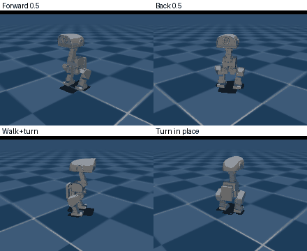

# XGO 小鸭子行走策略（从零训练 · stage E）



XGO Duck 双足小鸭子的强化学习行走策略：在 mjlab（MuJoCo Warp）里从随机初始化开始训练，分阶段加入速度、转向奖励。当前 **stage E** 是前进、后退、转向最均衡的一版。**只在仿真中验证，还没上真机。**

| 项目 | 数值（仿真，48 只鸭子平均） |
|---|---|
| 直线速度 | 命令 0.5 → 0.47 m/s，0.7 → 0.54，1.0 → 0.55，后退 1.0 → 0.46 |
| 原地转向 | 命令 1.5 → 左 1.52 / 右 1.75 rad/s；命令 3.0 → 2.8 |
| 边走边转 | 0.5 m/s + 1.5 rad/s → 前进 0.41–0.42、转 1.45–1.52 |
| 摔倒率 | 除原地右转 2% 外均为 0 |
| 训练量 | 约 4100 轮，4096 并行环境，RTX 单卡 |
| 模型 | `models/xgoduck_walk_stageE.onnx` |

## 各阶段对比

<table><tr>
<td></td>
</tr><tr>
<td>C 学会了转但转过头约 45%；D 把转向收过头，原地几乎不转；E 取中间值，转向跟上、速度不退步。直线速度目前都卡在约 0.55 m/s。</td>
</tr></table>

## 版本演进

| 阶段 | 做了什么 | 结果 |
|---|---|---|
| A | 从零学走路：窄速度核 std 0.22、命令 ±0.6、关节超速惩罚 | 会走 |
| B | 命令 ±1.0、步幅 ×1.8、腾空 0.15–0.5 s、线速度“进度”奖励 | 0.5–0.6 m/s，不会原地转 |
| C | 加转向“进度”奖励（权重 4） | 会转，但 1.5 → 2.25 rad/s 转过头 |
| D | 转向奖励降到 1、容差收紧 | 速度最好，原地转退化到 ~0 |
| **E** | 从 C 续练，转向权重 2.5、容差 0.8 | **最均衡（本仓库模型）** |
| F（进行中） | 冲 1 m/s：步幅 ×2.3、舵机余量放宽到 7.4 V 下 90% | 训练中 |

## 快速开始

依赖 [xgoduck_rl](https://github.com/LuwuDynamics/xgoduck_rl)（mjlab 环境，WSL2 + CUDA）。

```bash
cd ~/duck/xgoduck_rl
# 训练（脚本里的 T 指向本仓库 train/ 目录）
SCR_STAGE=E .venv/bin/python /path/to/train/duck_scratch.py --env.scene.num-envs 4096 --agent.max-iterations 600
# 验收：各速度/转向命令下的实际速度与摔倒率
.venv/bin/python /path/to/train/accept_speed.py <model.onnx>
```

上真机前需要：吊绳或限位、急停，先短测低速。

## 目录

```
train/duck_real.py      电机/舵机模型、真实参数、ONNX 推理封装
train/duck_scratch.py   从零训练的奖励与命令设置（SCR_STAGE=A..F）
train/train_*.sh        各阶段训练脚本（续练、导出 ONNX）
train/accept_speed.py   速度/转向验收
train/render_motion.py  渲染动图
models/                 导出的策略模型
docs/img/               README 图片
```
